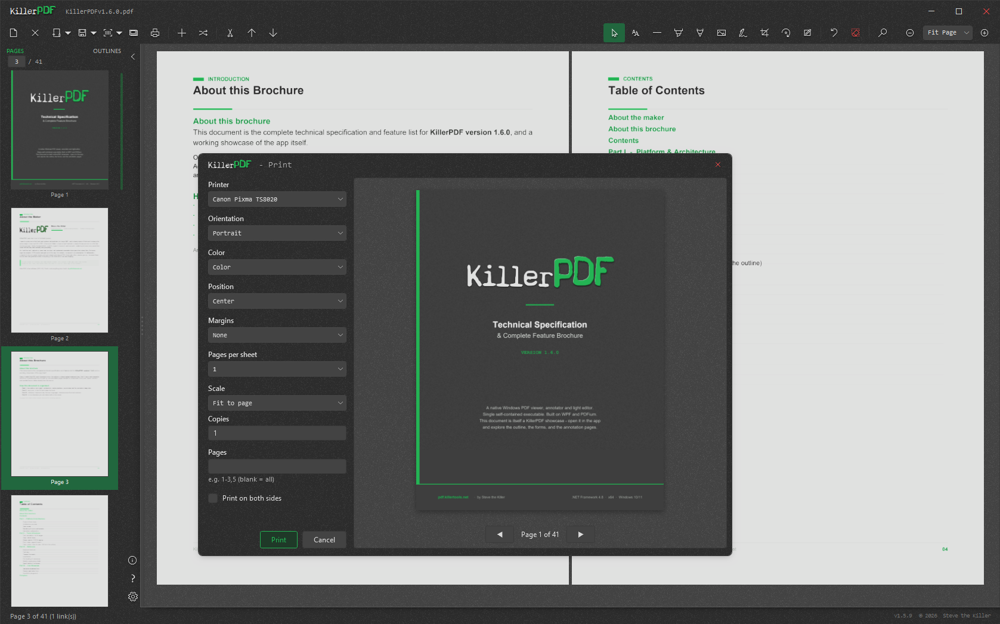
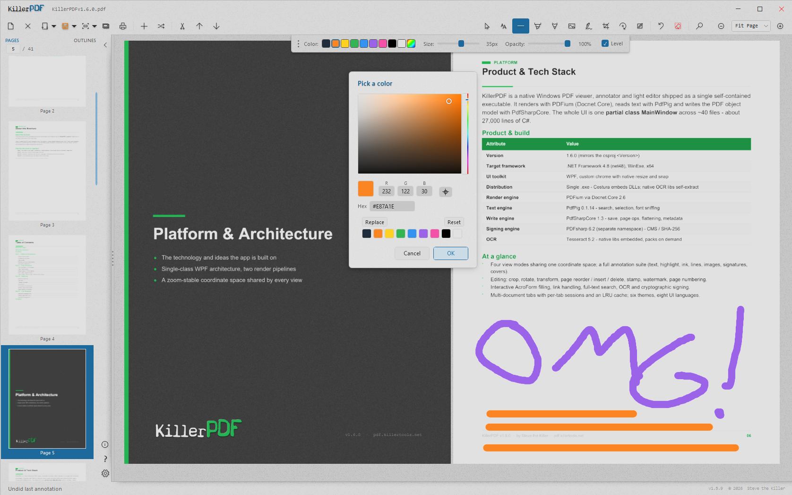
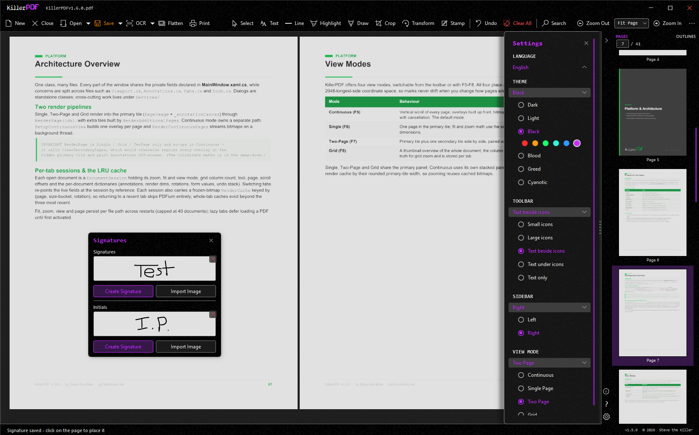
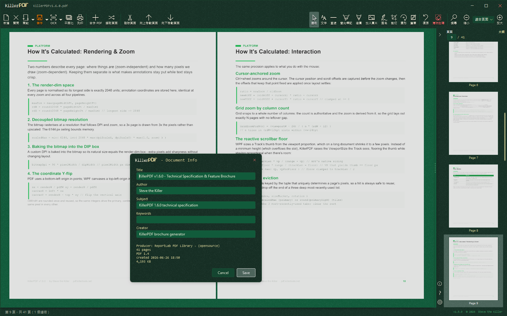
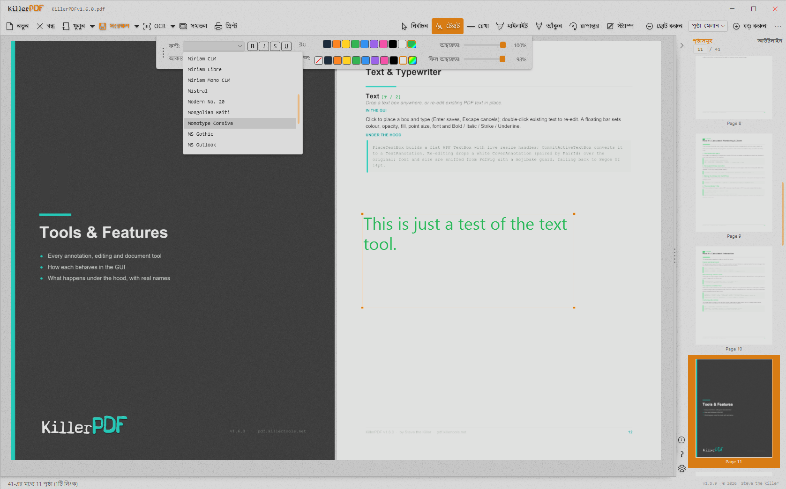
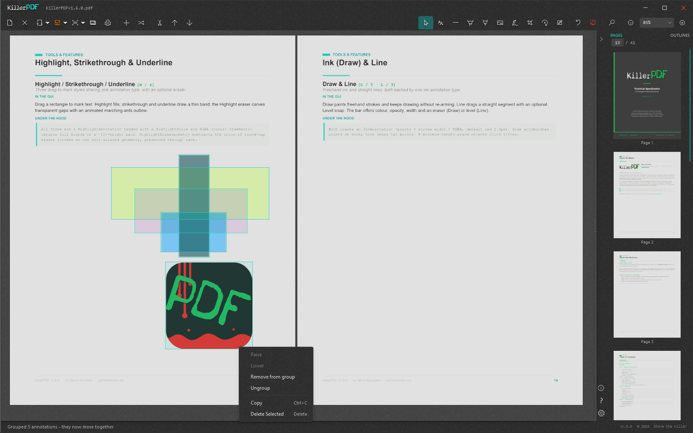

<p align="center">
  <a href="https://killerpdf.net"></a>
</p>

KillerPDF is a free, open-source PDF editor for Windows. View, annotate, OCR, merge, split, edit text, draw, sign, fill forms, print, flatten, and open password-protected PDFs without an Adobe subscription. Choose the compact Windows installer or the self-contained portable edition. Document processing stays on your computer, with no telemetry.

Full how-tos live on the [help page](https://killerpdf.net/help.html); internals, formats, and limits on the [technical page](https://killerpdf.net/technical.html).

## 本分支微調版／About this fork

**1.8.91-office-ux.7** · Original project: [SteveTheKiller/KillerPDF](https://github.com/SteveTheKiller/KillerPDF) · This fork: [jensen0915/KillerPDF](https://github.com/jensen0915/KillerPDF)

這是在原開源 KillerPDF 1.8.91 基礎上延續修改的一版，針對台灣辦公文件的閱讀、填寫、簽名與寄回情境調整操作與繁中用語。本分支依舊遵循原專案的開源原則，沿用 **GNU GPLv3**，保留原作者與貢獻者的署名及授權資訊，並提供對應版本的原始碼與建置方式。這是衍生微調版，不是原專案的官方發佈。

This is a follow-up refinement of KillerPDF 1.8.91 for everyday office documents and Traditional Chinese workflows in Taiwan. It continues under **GNU GPLv3**, retains upstream attribution and license notices, and provides corresponding source and build instructions. It is a modified fork, not an official upstream release.

- 依工作分組的辦公工具列：閱讀、填寫與簽名、註解、整理頁面，並顯示「已儲存／尚未儲存」；可切回原版工具列。
- 插入日期（西元或民國年）與勾選記號；「新增文字」工具可直接拖曳已放置的內容，編輯框有移動把手。
- 原生 WPF 墨跡手寫簽名：可復原上一筆，預設不存到本機。
- 表單可用 Tab／空白鍵操作，可開關「提示填表欄位」；列印頁碼接受全形數字與頓號。
- 台灣繁中用語；繁中環境下中文以正黑體輸出，勾選記號改用符號字型。
- **檔案 → 匯出相容副本** 產生以頁面影像組成的副本；文字無法選取、表單無法再填，目前文件與未儲存的修改會保留。

[繁中操作說明](OFFICE_UX.md) · [驗證結果與待驗項目](OFFICE_UX_VALIDATION.md) · [發佈方式與目前狀態](PROJECT_STATUS.md) · [從舊版 fork 移植的紀錄](docs/PORT_FROM_FORK.md)

This fork's Releases ship an unsigned single-file `KillerPDF-Portable.exe` that includes the .NET runtime; building from source needs the .NET 10 SDK. The in-app update check still points to the upstream project, so take fork updates from this fork's Releases.

## The KillerPDF.Engine

KillerPDF 1.8 introduces The KillerPDF.Engine, an independent and reusable .NET library for PDF 2.0, PDF/A, and PDF/UA document processing. It is a first-class area of this monorepo with its own public API, tests, corpus tooling, architecture documentation, [README](engine/README.md), and release history.

## Features

- High-quality PDFium rendering with four view modes (Single, Continuous, Two-Page with a book layout option, Grid), tabbed documents, and a split pane for two documents side by side
- Annotate with inline text editing and font matching, word-wrapping text boxes, drawing, lines, highlights, images, and page-number or watermark stamps. Highlights use the Multiply blend so the text underneath stays readable, and every tab has its own undo and redo history.
- Built-in OCR (Tesseract bundled, no cloud): make searchable PDFs, OCR a page or region to the clipboard, extract all text; extra languages download on demand
- Organize pages: merge, split, insert, rotate, crop, extract, delete, drag-and-drop reordering; drop a folder or `.zip` onto the window to merge its contents
- Export one page or a multi-page selection as PNG or JPEG directly from the Pages panel
- Transform: rotate, scale, flip, deskew by drawing a level line, perspective correction for photographed pages, and a LEVELS section (black point, white point, midtones) for pale scans
- Forms: fill text, checkbox, radio, and comb fields as live controls and save back; digital signatures with a certificate from Windows or a .pfx file, plus drawn or imported signatures and initials
- Print with a real in-app preview, paper size and source selection, scale / position / margins / pages-per-sheet options at 300 DPI; Save Flattened rasterizes to a fully uneditable PDF
- Full-text search with highlighting, and column-aware text selection that copies multi-column pages in reading order
- Night-mode inversion works independently in each split pane. Thirteen themes, live accent colors, and toolbar styles provide 41 looks, while the resizable sidebar can dock on either side.
- Localized UI in 19 languages, including Vietnamese, Kazakh, and Russian (contribute via `TRANSLATING.md`); full keyboard shortcut overlay on F1 with list and visual keyboard views, a shortcut toggle, and an always-available Ctrl+Shift+K recovery chord
- Opens password-protected PDFs (prompts instead of erroring) and repairs damaged ones
- Separate standard and portable downloads: the compact installer supports per-user or machine-wide deployment, while the larger portable edition includes its own runtime
- Standards-safe saves: every release is tested against a 2,900-file veraPDF conformance corpus with a zero-regressions requirement. See [validation/RESULTS.md](validation/RESULTS.md).
- No account or telemetry. Optional startup update checks contact GitHub and are enabled by default; downloading and installing an update requires confirmation. Turn checks off in About or the update dialog. Extra OCR languages download on demand.

## Command line

Every core operation also runs headless from a terminal, with meaningful exit codes, even while the app is open:

```powershell
KillerPDF.exe --merge out.pdf a.pdf b.pdf scan.jpg
KillerPDF.exe --extract-pages in.pdf 1-3,5 out.pdf
KillerPDF.exe --split in.pdf pages\
KillerPDF.exe --decrypt locked.pdf open.pdf [--password p]
KillerPDF.exe --to-image in.pdf imgs\ --dpi 300 --format jpg
KillerPDF.exe --flatten in.pdf flat.pdf
KillerPDF.exe --print in.pdf --printer "HP LaserJet" --pages 1-4 --copies 2
KillerPDF.exe --ocr scan.pdf searchable.pdf --lang eng
KillerPDF.exe --batch-resave inDir\ outDir\ --log report.csv
KillerPDF.exe --help
```

Full reference on the [help page](https://killerpdf.net/help.html).

## Screenshots

| | |
| --- | --- |
| <br>**Annotations.** Highlight text, draw with the pen, and add text boxes. | <br>**PDF comparison.** Review highlighted differences and a summary of changed pages. |
| <br>**Dual pane.** Work in two documents at once, each with its own tabs. | <br>**OCR languages.** Pick a recognition language, with more available to download. |
| <br>**Watermarks and page numbers.** Preview a watermark and set page numbers before applying. | <br>**Transform.** Rotate, scale, flip, and skew pages with a live preview. |

## Requirements

- Windows 10 or 11 (x64)
- The standard installer uses the .NET 10 Desktop Runtime and offers to install it when needed.
- The portable package includes the runtime and works offline without installation.

## Download

WinGet:

```powershell
winget install killerpdf
```

Chocolatey:

```powershell
choco install killerpdf
```

- Standard installer: <https://github.com/SteveTheKiller/KillerPDF/releases/latest/download/KillerPDF.exe>
- Portable edition: <https://github.com/SteveTheKiller/KillerPDF/releases/latest/download/KillerPDF-Portable.exe>
- Source (GPL3 corresponding source for this release): <https://github.com/SteveTheKiller/KillerPDF/releases/download/v1.8.91/KillerPDF-1.8.91-src.zip>

## Build from source

```powershell
git clone https://github.com/SteveTheKiller/KillerPDF.git
cd KillerPDF
dotnet publish -c Release
```

Output lands in `bin/Release/net10.0-windows/publish/`. Normal publishing produces the development build plus a versioned `KillerPDF-<version>-src.zip`. The release pipeline builds `KillerPDF.exe`, a compact framework-dependent installer, and `KillerPDF-Portable.exe`, a self-contained offline edition. Installed shortcuts launch the inner app directly for faster startup.

KillerPDF 1.8 requires the .NET 10 SDK. Both the reusable engine and the Windows application target .NET 10, with the application using `net10.0-windows`.

The desktop document pipeline now uses The KillerPDF.Engine for document parsing, writing, editing, repair, forms, annotations, signatures, and preservation-sensitive page operations. PDFium remains the rendering backend, while PdfPig handles text extraction.

## Translations

UI strings live in `Strings/` (one XAML `ResourceDictionary` per locale). To add or improve a language, see [TRANSLATING.md](TRANSLATING.md). Missing keys fall back to English, so a partial translation is fine.

## Changelog

See the [KillerPDF application changelog](CHANGELOG.md) and [The KillerPDF.Engine changelog](engine/CHANGELOG.md).

## License

GPLv3. See [LICENSE](LICENSE). If you fork, modify, or redistribute KillerPDF, your version must also be released under GPLv3 with source available. No exceptions for commercial rebrands.
